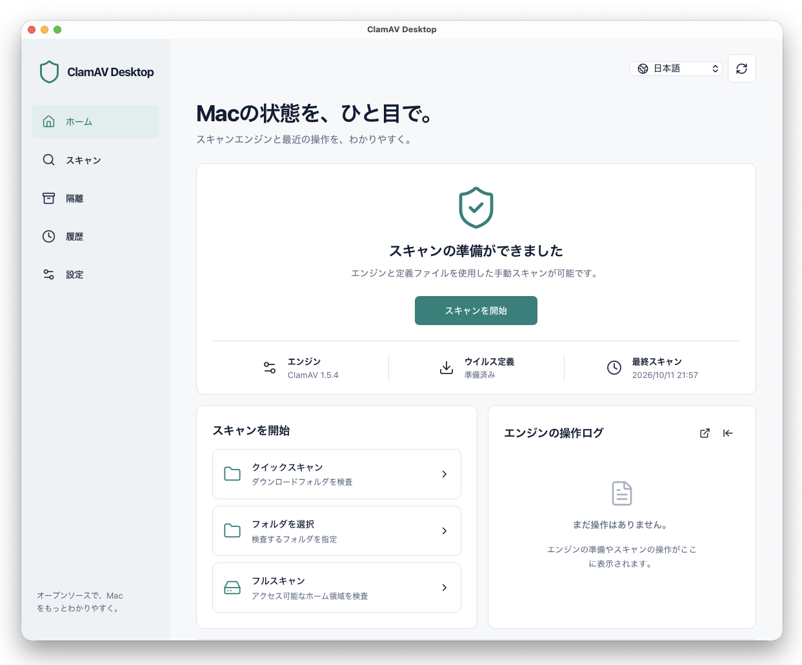

# ClamAV Desktop



macOS用のClamAVフロントエンド。Tauri 2とRustで処理・状態を管理し、ReactのWebViewで操作します。表示言語は日本語、English、简体中文です。

## 起動

必要環境：macOS 12以降、Xcode Command Line Tools、Node.js 20.19以降または22.12以降、Rust 1.88以降。

```sh
npm ci
npm run tauri dev
```

開発用アプリを作成するには：

```sh
npm run tauri -- build --debug --bundles app
```

出力：`src-tauri/target/debug/bundle/macos/ClamAV Desktop.app`。このアプリ自体の配布署名・公証はまだ行っていません。

## 使い方

1. 既存の公式PKG版またはHomebrew版ClamAVを自動検出します。未導入の場合は「エンジンを準備」から公式PKGをダウンロードします。固定したCisco公開鍵でPGP署名を検証し、Appleの署名・公証確認を通過したものだけをmacOS Installerで開きます。管理者認証とインストール完了はmacOSの画面で操作してください。
2. 定義がなければ「定義ファイルを更新」。FreshClamはアプリ専用のデータ領域に書き込みます。既存のHomebrew定義は読み取りにのみ使用します。
3. クイック検査はDownloads、フル検査はアクセス可能なホーム領域、カスタム検査は選択したフォルダを対象にします。全ディスクアクセスが必要な場合は設定画面からmacOSのプライバシー設定を開けます。
4. 検出結果を確認して手動で隔離します。ファイルのハッシュ確認と移動後の再検査を行い、復元時は既存ファイルを上書きしません。同一ボリュームでは原子的に移動します。別ボリュームでは専用一時領域に元ファイルを保持し、コピーの同期・ハッシュ照合・再検査後に隔離を確定します。転送先の空き容量と1MiBの余裕を確認し、コピー・同期・再検査が終わるまで元ファイルを移動しません。exFATの隔離先は保護されたアプリ領域で、exFATへの復元は元の権限制御を再現できません。exFAT上の短時間の元ファイル待避領域は非公開の隔離領域ではなく、中断時には復旧が必要です。中断した未確定転送は再起動時に巻き戻します。ボリュームが未接続、または復元先が競合する場合は両方のデータを残し、隔離画面から復旧を再試行できます。
5. 履歴はSQLiteに保存し、JSONでエクスポートできます。操作ログは左右にドッキングするか、独立したウインドウにできます。

アプリ起動中のみ予約検査と6時間ごとの定義更新を実行します。アプリ終了中に常駐するサービスやリアルタイム遮断はありません。アクセス不能・サイズ制限は検査未完了として表示します。XProtectとGatekeeperを引き続き利用してください。

## 検証

```sh
npm run build
npm test
cargo test --manifest-path src-tauri/Cargo.toml
```

ClamAVがある環境では、独自の無害なテスト署名を使った実プロセス検証も可能です：

```sh
cargo test --manifest-path src-tauri/Cargo.toml actual_clamav_streams_clean_and_detected_files -- --ignored
```

公式PKG検証テストは、公式のPKGと同名の`.sig`を用意して`CLAMAV_TEST_PKG`にPKGのパスを指定します。Apple署名確認には通常のmacOS信頼サービスへのアクセスが必要です。このテストはインストールしません。

検証用DMGは`npm run dist:mac`で作成します。署名・公証と更新手順は[release](docs/release.md)を参照してください。

実装と検証の進捗は[roadmap](docs/roadmap.md)、構成は[architecture](docs/architecture.md)を参照してください。

## English

A macOS ClamAV frontend with Rust-owned state and a Tauri 2 WebView. It supports engine discovery, verified official installer downloads, FreshClam updates, cancellable scans, SQLite history, explicit quarantine and safe restore, daily scheduling while the app is open, and a dockable/floating activity panel. No files are automatically deleted. Cross-volume quarantine keeps a staged source until a verified copy and durable commit complete; interrupted transfers roll back without overwriting existing files. The app itself is an unsigned development build; native installer authentication remains in macOS Installer. Run `npm ci` then `npm run tauri dev`.

## 简体中文

这是基于Tauri 2与Rust的macOS ClamAV前端，支持引擎检测、官方安装包签名验证、FreshClam更新、可停止的扫描、SQLite历史记录、手动隔离与安全恢复，以及可停靠或浮动的操作日志。支持英语、日语和简体中文。预约扫描仅在应用运行期间执行，不提供实时拦截，不自动删除文件。跨卷隔离会保留暂存源文件，在复制同步、哈希及复检通过后提交；中断的未提交传输会回滚，且不会覆盖已有文件。当前应用是尚未签名及公证的开发版本；安装引擎时请在macOS Installer中完成管理员认证。执行`npm ci`后运行`npm run tauri dev`。

Cross-volume transfers check destination capacity plus a 1 MiB reserve and retain the original through copy verification. exFAT quarantine stores the authoritative copy in private app storage; restoring to exFAT cannot reproduce POSIX permissions. Source staging on exFAT is not private isolation.

跨卷传输检查目标可用空间并预留1 MiB，在副本验证完成前保留原文件。exFAT文件隔离至应用的私有存储；恢复至exFAT无法还原POSIX权限。exFAT上的源文件暂存区不提供私有隔离。

設定画面でインストーラーダウンロードの容量と削除候補を確認できます。30日以上更新されていない管理対象だけを削除し、準備済みPKGは保持します。隔離の「詳細」では復旧状態、パス、容量、記録済みハッシュを確認できます。復元済み・失敗済みの記録も表示できます。

Settings shows installer cache usage and lets you remove managed attempts unchanged for 30 days while protecting the prepared package. Quarantine details shows recovery state, paths, sizes and the recorded hash, including restored or failed records.

设置显示安装程序缓存容量，可清理30天未更新的托管下载，并保护已准备的安装程序。隔离详情显示恢复状态、路径、容量及记录的哈希值，也可查看已恢复和失败的记录。

保持期間（1〜365日）とダウンロード容量上限（257〜16,384MiB）を設定・保存できます。容量上限は新規取得時に適用し、既存ファイルは自動削除しません。隔離一覧はパス・検出名・状態で検索し、新旧順・パス順・確認が必要な順に並び替えられます。

Configure retention (1–365 days) and the managed download limit (257–16,384 MiB). New downloads reserve space for the maximum package and signature; existing files are never automatically deleted. Search quarantine by path, detection or localized status and sort by date, path or attention needed.

可设置保留期限（1–365天）与托管下载容量上限（257–16,384 MiB）。新下载预留安装包及签名的最大空间；不会自动删除已有文件。隔离列表支持按路径、检测名称或本地化状态搜索，并按日期、路径或处理优先级排序。

隔離の詳細から「SHA-256を再確認」を実行できます。最終確認日時・一致/不一致・実測ハッシュを保存します。ウイルスの再検査や自動削除は行いません。未完了転送では直近の復旧失敗の理由、試行日時、診断詳細を確認し、復旧を再試行できます。

Quarantine details can recheck SHA-256 and save the timestamp, comparison result and measured hash. This does not rescan for malware or delete files. Unfinished transfers show the last recovery failure, attempt time, expandable diagnostics and a retry action.

隔离详情可重新检查SHA-256，并保存检查时间、比较结果及实际哈希值。此操作不重新扫描病毒，也不删除文件。未完成的传输显示最近恢复失败的原因、尝试时间及可展开的诊断信息，并支持重试。

隔離一覧から全記録と最終確認結果をJSON出力できます。検索条件は出力に適用しません。整合性確認中は容量・割合を表示し、「確認を停止」で中断できます。中断結果に途中ハッシュは含めず、ファイルは保持します。

Export all quarantine records and latest integrity results as JSON regardless of search filters. Integrity checks show byte/percentage progress and can be stopped. Stopped checks retain the file and never publish a partial digest.

可将全部隔离记录及最近完整性结果导出为JSON，不应用搜索筛选。完整性检查显示容量与百分比进度，并支持停止。停止的检查保留文件，不输出未完成的哈希值。

設定の「診断と再試行」でエンジン・定義更新の直近の失敗理由、診断詳細、再試行案内を確認できます。更新制限には待機期限を表示し、連続実行を抑制します。「診断情報をJSON出力」で状態・設定・ログ・隔離情報などをまとめて保存できます。パスを含むため、共有前に内容を確認してください。

Settings provides persistent engine/update failure diagnostics and retry guidance. Rate limits show a retry deadline and suppress repeated attempts. Export a support JSON containing local state, settings, logs and quarantine information; review included paths before sharing.

设置提供持久化的引擎/病毒库更新失败诊断与重试说明。限流时显示等待期限并抑制重复尝试。可导出包含本地状态、设置、日志及隔离信息的诊断JSON；共享前请检查其中的文件路径。
